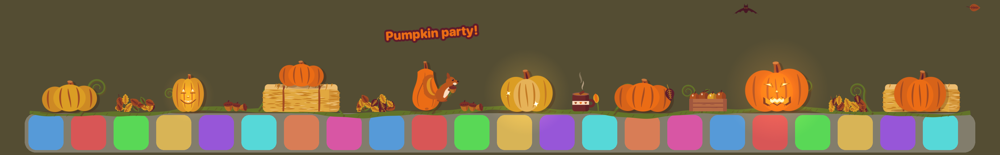

# Fall Dock 🎃

A cozy little Mac app that fills the top of your Dock with a fall harvest: flat, hand-drawn pumpkins on a
curling vine, evenly spaced, with hay bales, leaf piles, acorns, a crate of apples, a steaming mug of cider
and a glowing lantern in between. A squirrel stops by now and then.

If your Dock magnifies, everything grows, rises and spreads apart with the icons under the pointer.

Things to try:

- **Click a pumpkin** to smash it. Chunks and seeds go flying, and a new one grows back a few seconds later.
  Smash a few in a row for a combo.
- **Drag a pumpkin and throw it.** It bounces along the Dock and hops back to its spot, splats if it lands hard,
  knocks over any pumpkin it hits, and is gone if you throw it off the end of the Dock.
- **Golden pumpkins** turn up now and then, sparkling. The 🎃 menu counts the ones you've found.
- **Jack-o'-lanterns:** in the evening (and all through Halloween week) some pumpkins are carved with glowing,
  flickering faces that flare up when you point at them. Smash one and a bat flies out.
- **Click the acorns** to knock one out, and the squirrel comes to fetch it.
- **Click a leaf pile** to kick it into the air, the mug for a puff of steam, or the lantern to make it flare up.
- **Sweep the pointer quickly across the pumpkins** to rock them. Now and then a gust of wind blows leaves along
  the Dock and everything sways.

## What you need

- A Mac running macOS 13 Ventura or newer.
- **Xcode** (free from the Mac App Store).

## Run it from Xcode

1. Double-click **`FallDock.xcodeproj`** to open the project in Xcode.
2. Press **⌘R** (or the ▶︎ Run button at the top left).
3. A 🎃 appears in your menu bar and pumpkins appear on your Dock. Click one!

To stop it, press **⌘.** in Xcode or choose **Quit Fall Dock** from the 🎃 menu.

### Keep a copy in Applications

In Xcode choose **Product → Archive**, then **Distribute App → Custom → Copy App**, and drag the exported **Fall Dock.app** into your Applications folder. Then turn on **Open at Login** in the 🎃 menu.

## The 🎃 menu

- **Show Pumpkins**: hides or shows everything.
- **Vines**: a single pumpkin vine along the Dock, behind the pumpkins, with fine ridges, two-tone curls and buds.
- **Cozy Extras**: the hay bales, leaf piles, acorns, apples, mug, lantern and the squirrel. The lantern glows brighter in the evening.
- **Falling Leaves**: a leaf drifts down onto the Dock every few seconds.
- **Sounds**: soft sounds made in code: a squishy thump for smashes, pops, rustling leaves, bounces, a chime for golden pumpkins and the wind.
- **Jack-o'-Lanterns**: In the Evening (from 6 pm, and all of Halloween week), Always or Never.
- **How Full**: A Few, Plenty or Overflowing, which sets how closely pumpkins and extras are packed. They always stay the same size: when the Dock gets longer or shorter (adding apps, or changing its size in System Settings), pumpkins and extras grow in or shrink away at the end instead of everything stretching.
- **Grow New Pumpkins**: a fresh set of pumpkins.
- **Fit Pumpkins to Dock Exactly…**: by default the app estimates how wide your Dock is. If the pumpkins hang past the ends of your Dock, allow Fall Dock under System Settings → Privacy & Security → Accessibility and it will measure the Dock exactly. It only reads the Dock's size.
- **Open at Login**: starts Fall Dock when you log in (use the copy in Applications).

## Good to know

- Pumpkins only show when the Dock is at the **bottom** of the screen. They hide and come back with the Dock (for example in full-screen apps), and follow it to another display.
- Clicks only stop at a pumpkin or a cozy extra (and while you're holding a pumpkin). Everywhere else, the Dock and your windows work normally.
- Magnification follows the Dock's own setting (System Settings → Desktop & Dock → Magnification).
- All the art is drawn in code (see `FallDock/Art/Art.swift` and `FallDock/Art/CozyArt.swift`), in the flat style of a hand-drawn harvest wagon, using six colors. You can change them in `Palette` near the top of the file.

## How it works

Like Festivitas, Fall Dock doesn't change the Dock itself. It floats a transparent, click-through window just above the Dock, on every desktop.

| File | What it does |
|---|---|
| `App/FallDockApp.swift` | Starts the app (SwiftUI) and puts the 🎃 menu in the menu bar |
| `App/MenuContent.swift` | The 🎃 menu (SwiftUI) |
| `App/AppModel.swift` | What the menu shows and changes |
| `App/Settings.swift` | Remembers your menu choices |
| `Overlay/DockLocator.swift` | Works out where the Dock is, which display it's on and whether it's showing |
| `Overlay/OverlayController.swift` | Places the transparent window and lets clicks reach a pumpkin only when the pointer is over one |
| `Overlay/PumpkinScene.swift` | Pumpkins, the vine, following the Dock's magnification, wobbling, smashing, regrowing and falling leaves (SpriteKit) |
| `Overlay/PumpkinScene+Cozy.swift` | The cozy extras and the squirrel |
| `Overlay/PumpkinScene+Fun.swift` | Tossing pumpkins, combos, golden pumpkins, jack-o'-lanterns, bats, gusts of wind and treats for the squirrel |
| `Overlay/DockSprite.swift` | The Dock's magnification curve, and the base class for everything that sits on the Dock |
| `Art/Art.swift` | Draws the pumpkins, the vine and the leaves |
| `Art/CozyArt.swift` | Draws the hay bales, leaf piles, acorns, apples, mug, lantern and squirrel |
| `Art/FunArt.swift` | Draws the jack-o'-lantern faces, sparkles, bats, the squirrel's acorn and the combo words |
| `Art/Sounds.swift` | Makes all the sounds from scratch |

The menu and app are SwiftUI. The overlay above the Dock uses AppKit and SpriteKit, because SwiftUI windows can't float above the Dock or let clicks pass through them.

## Not done yet

- Docks on the left or right edge. Auto-hiding Docks aren't tested yet.
- A proper app icon.
- Signing with an Apple Developer account so other people can download it.
