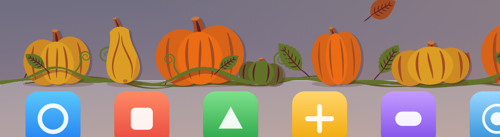
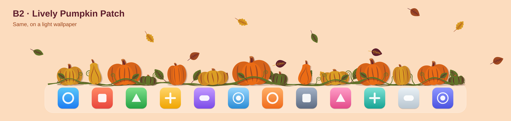
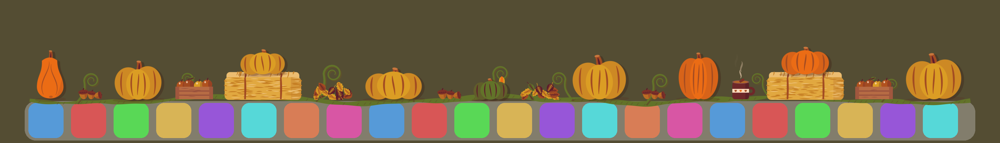
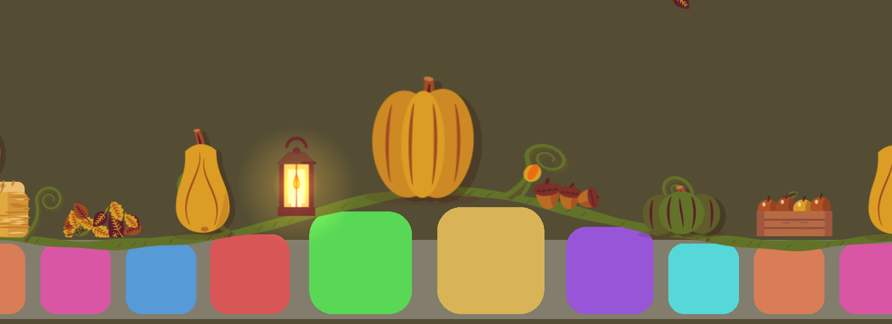
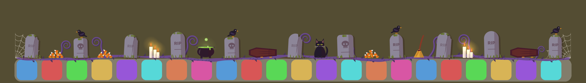

# Dockorate 🎃

*Decorate your Dock for every season.*

A cozy little Mac app that decorates the top of your Dock for the season. Fall is the first: a harvest of flat, hand-drawn pumpkins on a
curling vine, evenly spaced, with hay bales, leaf piles, acorns, a crate of apples, a steaming pumpkin spice latte
and a glowing lantern in between. A squirrel stops by now and then: it picks up an acorn and carries it
back the way it came (with the acorns switched off, it just hops across).

If your Dock magnifies, everything grows, rises and spreads apart with the icons under the pointer.

Click a pumpkin to smash it. Chunks and seeds go flying, and a new pumpkin grows back a few seconds later.
Click a leaf pile to kick it into the air, the latte for a puff of steam, or the lantern to make it flare up.
Sweep the pointer quickly across the pumpkins to rock them, and get close to the squirrel to scare it off.









## Themes

**Fall** is the original theme, and it's what you get unless you pick another. Themes are **seasons** or **festivals**, and more of both are on the way. On the **Themes** page of the app window (or **Theme** in the 🎃 menu):

- **Change automatically**: the season, with each festival taking over for the days before its day (to start with a week, so Halloween from October 24th through the 31st). A season stays on until the next one starts, so for now that's Fall between festivals. Switched on, the page shows the year as a ribbon from January through December (each season, each festival's days picked out, the months and today; point at a festival's days or click them for its name and dates), **Festivals show up**: how long before its day each festival goes on (3 days, 1 week, 2 weeks, 3 weeks or 1 month), the next two changes with a countdown, and **In the rotation**: a switch for each theme, so you can leave out any you don't want. A season left out lets the one before it stay on longer, a festival left out leaves its days to the season, and the last season can't be switched off. Every theme is in the rotation to start with, and new themes join it by themselves. The Dock changes by itself on the day, even if the app has been running for days.
- **Pick a theme**: a picture card for each theme, two to a row. Clicking one keeps it on your Dock all year (and switches off Change automatically).

Switching is smooth: the old harvest fades away while the new one grows in from left to right, and the app window, the live harvest and the desktop picture (with Background on) cross-fade to the new theme. The Customize page follows the theme on the Dock, and its drop-down menu lets you look at and set up any other theme ahead of time. Every theme keeps its own extras, so turning off the hay bales in Fall leaves Halloween alone.

Each theme is a case of `Settings.Theme`: a season says the day it starts, and a festival says its day each year (worked out per year, so festivals that move around work too). It also lists its own extras, perch, vine and pictures, so a new theme only has to say what it brings.

### Halloween

- The orange pumpkins become **jack-o'-lanterns** with glowing yellow carved faces: pointy eyes and a toothy grin, happy closed eyes, big round eyes, or a mischievous jagged smile. Their candles flicker, and flare up when you point at one. Smash one and assorted candy flies out, and a bat that was hiding inside flutters away. A few pale ghost pumpkins sit among them.
- **Purple graveyard dirt** runs along the Dock instead of a vine, lumpy, with pebbles and tufts of grass, and a **cobweb** strung in each top corner of the Dock, fanning down across its ends, with a spider slowly lowering itself on its thread.
- Spooky extras, each with a click: **tombstones** (a zombie hand reaches up out of the dirt and waves), a **black cat** that blinks and swishes its tail (its eyes go wide when you point at it, and it meows when clicked), a **bubbling cauldron**, a pile of **assorted candy** that flies when clicked, **dripping candles** that blow out and relight, a **skull** whose jaw chatters, and gnarled **crypt pedestals** with a jack-o'-lantern on top.
- **Bats** flutter past now and then instead of falling leaves.
- **Haunting while you're away**: leave the Mac alone for two minutes and the Dock gets haunted. Wispy ghosts drift in from the sides of the screen and gather over the Dock, circling, glowing eyes open one by one over the jack-o'-lanterns and in the dark above them, blinking and looking around, and the candles burn an eerie green. Touch anything (the mouse, a key) and the eyes snap shut, the ghosts dash off the nearest side and the candles warm up again. It only reads how long ago the Mac last had any input, never what was typed. It has its own switch on the Customize page, with **Try It** to haunt the Dock after just a moment's hands off (for showing someone).
- **Spirits of quit apps**: quit an app and a pale, hollow-eyed ghost of its own icon rises out of its spot in the Dock, sways, and drifts up off the screen. Open the app again within ten minutes and its spirit swoops back down into its icon with a soft flash. With Accessibility allowed it comes from the app's exact icon; without it, from among the open apps near the Dock's right end. It has its own switch on the Customize page.
- A cute **ghost** flies across above the Dock instead of the squirrel. Click it and it dashes off the side of the screen.
- With Background on, a quiet scene of its own: a **haunted house** with lit windows on a hill, a small moon (where Fall's sun is) with a few bats, and a graveyard in front with tombstones, crosses, an iron fence and a gnarled tree. The light picture is a violet and pumpkin-orange dusk; the dark one is a starry night with an eerie green glow and fog in the valley.



## What you need

- A Mac running macOS 13 Ventura or newer.
- **Xcode** (free from the Mac App Store).

## Run it from Xcode

1. Double-click **`FallDock.xcodeproj`** to open the project in Xcode.
2. Press **⌘R** (or the ▶︎ Run button at the top left).
3. A 🎃 appears in your menu bar and pumpkins appear on your Dock. Click one!

To stop it, press **⌘.** in Xcode or choose **Quit Dockorate** from the 🎃 menu.

### Keep a copy in Applications

In Xcode choose **Product → Archive**, then **Distribute App → Custom → Copy App**, and drag the exported **Dockorate.app** into your Applications folder. Then turn on **Open at Login** in the 🎃 menu.

## The app window

Open **Dockorate** from your Applications folder (or choose **Open Dockorate…** from the 🎃 menu) for the app's own window.
While it's open, Dockorate shows in the Dock and the app switcher like any app; close it and it goes back to living in the menu bar.
When Dockorate starts by itself at login, the window stays closed.

- **Home**: a live little harvest on a pretend Dock (click its pumpkins to smash them), whether the harvest is on your Dock right now, your smash count, and buttons to pause it for an hour, grow new pumpkins, or show or hide it.
- **Themes**: the theme on your Dock now, **Change automatically** with the year at a glance and what's coming up, and a picture card for each theme, two to a row (Fall is marked as the original).
- **Customize**: the theme on the Dock, with a drop-down menu to set up any other theme. For Fall: the vine, falling leaves and cozy extras, with a picture tile for each extra (hay bales, leaf piles, acorns, the latte, the lantern, the apples and the squirrel) to switch it on or off. With falling leaves on:
  - **Amount**: how many leaves fall, from a few to lots. The mark in the middle is the usual amount, and the slider snaps to it.
  - **Fill the whole screen** (off by default): leaves drift down across the whole screen the Dock is on and settle behind the Dock, instead of only just above it.

  For Halloween: the graveyard dirt, bats and spooky extras, with a tile for each (crypt pedestals, tombstones, the black cat, the cauldron, candy, candles, the skull and the ghost).
- **Background** (off by default): sets your desktop picture to go with the theme. The pictures stay minimal so the Dock is the star: every theme's sun or moon is small and in the same spot, with nothing big or bright to pull the eye. Each theme has a light and a dark picture. **Switch with Light and Dark** (on by default) shows the light one when the Dock is light and the dark one when it's dark; clicking a picture keeps that one instead. The pictures are drawn at each display's exact size and saved in `~/Library/Application Support/Dockorate/Wallpapers`. Your own picture for each display is saved first and comes back when Background is switched off (or by Reset everything). macOS only changes the desktop of the space you're on, so the picture is set again as you move between spaces, plug in displays or switch Light and Dark.
- **Settings**:
  - **General**: open at login, the 🎃 in the menu bar, and the smash sound.
  - **Dock**: how full the harvest is, and the Accessibility permission for an exact fit.
  - **Reset**: reset the smash count, or reset everything (every option back to how it started, the smash count back to zero, and a fresh harvest; open at login stays as it is). Both ask first.
  - **About**: the version, the welcome window again, and Quit.

## The 🎃 menu

- **Open Dockorate…**: the app window.
- **Show Pumpkins**: hides or shows everything.
- **Vines**: a single pumpkin vine along the Dock, behind the pumpkins, with fine ridges, two-tone curls and buds.
- **Cozy Extras**: the hay bales, leaf piles, acorns, apples, pumpkin spice latte, lantern and the squirrel. The lantern glows brighter in the evening.
- **Falling Leaves**: leaves drift down onto the Dock (how many, and whether they fill the whole screen, is set in Customize).
- **Smash Sound**: a soft, squishy thump when you smash a pumpkin.
- **How Full**: A Few, Plenty or Overflowing, which sets how closely pumpkins and extras are packed. They always stay the same size: when the Dock gets longer or shorter (adding apps, or changing its size in System Settings), pumpkins and extras grow in or shrink away at the end instead of everything stretching.
- **Grow New Pumpkins**: a fresh set of pumpkins.
- **Pause for 1 Hour**: hides everything for an hour, for presentations and screen sharing (or **Resume** early).
- **Theme**: Change Automatically, or one of the seasons or festivals, the same choice as the Themes page.
- **Fit Pumpkins to Dock Exactly…**: by default the app estimates how wide your Dock is. If the pumpkins hang past the ends of your Dock, allow Dockorate under System Settings → Privacy & Security → Accessibility and it will measure the Dock exactly. It only reads the Dock's size.
- **Open at Login**: starts Dockorate when you log in (use the copy in Applications).
- **Welcome to Dockorate…**: shows the welcome window again. It opens by itself the first time.

If you hide the 🎃 (Settings → General), open Dockorate from Applications to get back to the window.

## Good to know

- Pumpkins only show when the Dock is at the **bottom** of the screen. They hide and come back with the Dock (for example in full-screen apps), and follow it to another display.
- Clicks only stop at a pumpkin or a cozy extra. Everywhere else, the Dock and your windows work normally.
- With **Reduce Motion** on (System Settings → Accessibility → Display), nothing moves by itself: no wobbling, falling leaves, steam or squirrel. Things still react when you click them.
- **Fill the whole screen** uses a second see-through, click-through window over the Dock's screen. It hides with the harvest and stops drawing while hidden, but while it shows it uses a few percent of CPU, so it's off by default.
- Dockorate checks for the Dock often only while the pointer is near the bottom of the screen, so it uses very little battery while the Dock is hidden.
- Magnification follows the Dock's own setting (System Settings → Desktop & Dock → Magnification).
- The harvest follows your Mac's **Light or Dark** setting (System Settings → Appearance): rich, deep colors on a dark Dock, and softer, lighter ones on a light Dock. It switches straight away, keeping the same pumpkins.
- All the art is drawn in code (see `FallDock/Art/Art.swift` and `FallDock/Art/CozyArt.swift`), in the flat style of a hand-drawn harvest wagon, using six colors. You can change them in `Palette` near the top of the file.

## How it works

Like Festivitas, Dockorate doesn't change the Dock itself. It floats a transparent, click-through window just above the Dock, on every desktop.

| File | What it does |
|---|---|
| `App/FallDockApp.swift` | Starts the app (SwiftUI) and puts the 🎃 menu in the menu bar |
| `App/MenuContent.swift` | The 🎃 menu (SwiftUI) |
| `App/AppModel.swift` | What the menu shows and changes |
| `App/Settings.swift` | Remembers your choices, and resets them |
| `App/Welcome.swift` | The welcome window shown on first launch |
| `App/MainWindow.swift` | The app window |
| `App/MainView.swift` | The window's sidebar, and the Home and Settings pages |
| `App/ThemesPage.swift` | The Themes page, and the words for when the theme changes |
| `App/MainTabs.swift` | The Customize page, the cards and rows the pages are built from, and the live little harvest |
| `App/BackgroundPage.swift` | The Background page |
| `App/Wallpaper.swift` | Puts the theme's picture on the desktop, keeps it there across spaces and displays, and puts yours back |
| `Overlay/DockLocator.swift` | Works out where the Dock is, which display it's on and whether it's showing |
| `Overlay/OverlayController.swift` | Places the transparent window and lets clicks reach a pumpkin only when the pointer is over one |
| `Overlay/PumpkinScene.swift` | Pumpkins, the vine, following the Dock's magnification, wobbling, smashing, regrowing and falling leaves (SpriteKit) |
| `Overlay/PumpkinScene+Cozy.swift` | The cozy extras and the squirrel |
| `Overlay/PumpkinScene+Spooky.swift` | Halloween: jack-o'-lanterns, the spooky extras, zombie hands, the ghost, bats and cobwebs |
| `Overlay/PumpkinScene+Haunting.swift` | Haunting while you're away: when the Mac's been left alone, and the ghosts, eyes and green candles |
| `Overlay/PumpkinScene+Spirits.swift` | Spirits of quit apps: where each app's Dock icon is, which spirits left, and the spirits rising and coming back |
| `Overlay/ScreenLeafScene.swift` | Leaves falling across the whole screen, for Fill the whole screen |
| `Overlay/DockSprite.swift` | The Dock's magnification curve, and the base class for everything that sits on the Dock |
| `Art/Art.swift` | Draws the pumpkins, the vine and the leaves |
| `Art/CozyArt.swift` | Draws the hay bales, leaf piles, acorns, apples, pumpkin spice latte, lantern and squirrel |
| `Art/SpookyArt.swift` | Draws Halloween: jack-o'-lantern faces, crypt pedestals, tombstones, the black cat, the cauldron, candy, candles, the skull, the zombie hand, the ghost, bats, the spider, cobwebs and purple dirt |
| `Art/HauntingArt.swift` | Draws the haunting's glowing eyes and wispy ghosts, and quit apps' spirits |
| `Art/WallpaperArt.swift` | Draws each theme's light and dark desktop pictures |
| `Art/SmashSound.swift` | Makes the smash sound and the cat's meow from scratch |

The menu and app are SwiftUI. The overlay above the Dock uses AppKit and SpriteKit, because SwiftUI windows can't float above the Dock or let clicks pass through them.

## Tests

Run them in Xcode with **⌘U**, or from Terminal:

```sh
xcodebuild test -project FallDock.xcodeproj -scheme FallDock -destination 'platform=macOS'
```

They also run on GitHub (see `.github/workflows/tests.yml`) for every pull request and every push to `main`, `version-*` and `dockorate-*` branches, so a new feature can't quietly break an old one.

- **DockorateTests** (unit tests): settings and their defaults, carrying settings over from older versions, Reset Everything, how the harvest is laid out on Docks of different lengths, what each Customize and Settings switch changes, smashing, the Dock's magnification math, the art in light and dark, the Background pictures (each sun or moon small and in Fall's spot, Halloween's looking nothing like Fall's), and themes (Fall staying the default, festivals a week before their day or as early as picked, the rotation, each theme's harvest, the cobwebs in the Dock's top corners, and the crossfade between them).
- **DockorateUITests** (UI tests): open every page, flip the main switches, check choices survive a relaunch, Background starting off, picking a theme, changing automatically (and its year and rotation showing only while it's on, a festival's details only when pointed at or clicked, the year running January through December, picking how early festivals show up), the Themes page's layout, the Customize theme menu, Reset Everything asking first, and the license page when there's no license.

The tests never touch your own settings, license key, desktop picture or login items. Unit tests keep their settings in a throwaway place. UI tests start the app with `-UITesting` (see `App/AppEnvironment.swift`), which gives it fresh settings of its own and a pretend license, and stops it from changing the desktop or login items. The first UI test run asks to let Xcode control the app (System Settings → Privacy & Security → Accessibility).

Every feature and fix should come with a test (the rule is written down in `CLAUDE.md`, and the pull request template asks for it). When you add a feature, add a test for it next to the others, and give any new switch a `SettingRow` (or an `.accessibilityIdentifier`) so the UI tests can find it.

## The Mac App Store version

Dockorate also comes in a Mac App Store version: the `DockorateAppStore` scheme. It's sandboxed, paid for on the
App Store instead of with a license key, and updated by the App Store instead of Sparkle. See
[docs/AppStore.md](docs/AppStore.md) for how it differs, how to upload it, and what to fill in on App Store Connect.

## The app icon

The icon is `FallDock/Icon.icon`, an Icon Composer file. Open it in Icon Composer (Xcode > Open Developer Tool) to edit it. Xcode builds every icon size from it, including the older-style icon for macOS 13 to 15.

## Releasing

To let other people download Dockorate, it has to be signed with a Developer ID and notarized by Apple.

One-time setup:

1. Join the [Apple Developer Program](https://developer.apple.com/programs/).
2. In Xcode → Settings → Accounts, select your team, click **Manage Certificates…**, and add a **Developer ID Application** certificate.
3. Save your notarization login in the keychain (use an [app-specific password](https://support.apple.com/102654)):

   ```sh
   xcrun notarytool store-credentials Dockorate --apple-id you@example.com --team-id ABCDE12345
   ```

Then, for each release, set the version in Xcode (target → General → Version) and run:

```sh
TEAM_ID=ABCDE12345 scripts/release.sh
```

It builds, signs, notarizes and staples the app, and leaves a zip and a disk image in `build/release/` to put on
your website. The disk image opens a fall-themed window that asks people to drag Dockorate into Applications;
`scripts/make-dmg.sh` makes it (it can also wrap any build, signed or not). Its background is
`scripts/dmg/background.png` (plus `@2x`), drawn from the app's own art: pumpkins, vine, hay bale and leaves.
The first time, macOS may ask to let Terminal control Finder, which lays out the window.

## The project's name

Dockorate was called Fall Dock while it was being built, so the Xcode project, scheme, target and source
folder are still named `FallDock`. Only the app people see is called Dockorate. The first time Dockorate
starts, it brings over the choices and smash count saved by Fall Dock (bundle ID `com.amol.falldock`).

## Not done yet

- Docks on the left or right edge. Auto-hiding Docks aren't tested yet.
- Payments and license keys, automatic updates (Sparkle) and crash reporting.
